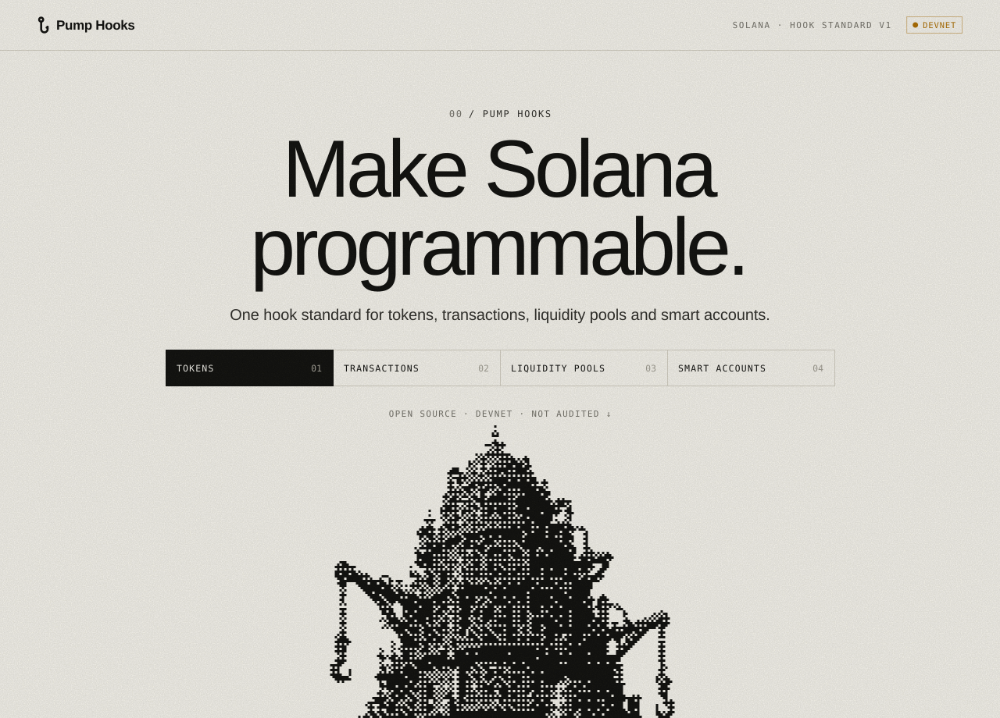
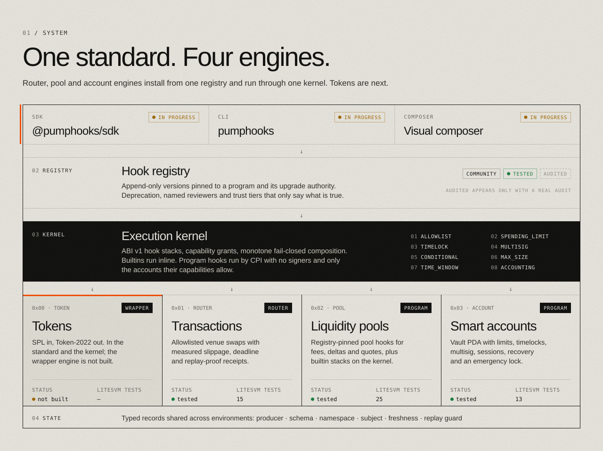

<p align="center">
  <a href="https://pumphooks.vercel.app"></a>
</p>

<p align="center">
  <a href="https://pumphooks.vercel.app"><b>Website</b></a> &nbsp;&middot;&nbsp;
  <a href="docs/ARCHITECTURE.md">Architecture</a> &nbsp;&middot;&nbsp;
  <a href="docs/STANDARD.md">Hook standard</a> &nbsp;&middot;&nbsp;
  <a href="docs/research">Research</a> &nbsp;&middot;&nbsp;
  <a href="SECURITY.md">Security</a>
</p>

<p align="center">
  
  
  
  
</p>

<br>

Uniswap v4 made a single AMM programmable. **Pump Hooks makes Solana execution programmable**
with one hook standard, one on-chain registry and one execution kernel. Three environments run on
them today: transactions, liquidity pools and smart accounts. The fourth, tokens, is defined in the
standard and supported by the kernel, but its engine is not built yet.

A hook is a small, versioned policy. It is published to an on-chain registry, installed into a
stack, and run before or after an operation. Each hook can **veto** that operation, and none can
override another hook's veto. A denial, an error or a missing piece of state reverts the whole
transaction.

<br>



<br>

## 01 &nbsp;/&nbsp; Four environments, one standard

Each environment states exactly how far its hooks reach. That boundary is part of the standard.
It is printed in the registry, in the SDK and in the UI.

| | Environment | Where hooks run | Can it be bypassed? | Status |
| --- | --- | --- | --- | --- |
| `0x00` | **Tokens** | Token-2022 transfer hook on a wrapped asset (SPL in, Token-2022 out) | Every transfer of the wrapped mint would run it. The original SPL token is unaffected. | **not built** |
| `0x01` | **Transactions** | `hook-router`: a route policy's stack around an allowlisted venue CPI | **Yes.** Anyone can call the venue directly. Router hooks are opt-in guardrails. | 11 tests |
| `0x02` | **Liquidity pools** | `hooks-core` PoolManager: one registry-pinned program hook (fees, deltas, quotes) plus an optional builtin stack | No, for pools created in this program. Other AMMs are out of scope. | 25 tests |
| `0x03` | **Smart accounts** | `smart-accounts` vault PDA, on deposit, withdraw, execute and governance | No. Funds only leave the vault through the hook stack. | 13 tests |

Router, pool and account hooks are all installed from `hook-registry` versions, and their builtin
stacks are all evaluated by `hook-kernel`. Pool program hooks use a richer pool interface on top of
ABI v1, because they can also price trades.

<br>



<br>

## 02 &nbsp;/&nbsp; Builtin hooks

Builtins run inline in the kernel, so they cost no CPI and are covered by property tests. Program
hooks are separate programs called by CPI. They receive no signers, and they get only the accounts
their granted capabilities allow.

| Id | Hook | What it enforces | Environments |
| --- | --- | --- | --- |
| 1 | `ALLOWLIST` | Actor or counterparty must be on an inline list or a verified state record | router, pool, account |
| 2 | `SPENDING_LIMIT` | Amount per asset per rolling period | router, pool, account |
| 3 | `TIMELOCK` | Operation needs a proposal older than the delay | account |
| 4 | `MULTISIG` | Threshold of approvals from a member mask | account |
| 5 | `CONDITIONAL` | If these premises hold, these requirements must too | router, pool, account |
| 6 | `MAX_SIZE` | Single operation cap per asset | router, pool, account |
| 7 | `TIME_WINDOW` | Absolute bounds and a daily UTC window | router, pool, account |
| 8 | `ACCOUNTING` | Records measured count and volume; never blocks | router, pool, account |

The kernel also defines token-environment support for allowlist, timelock, max-size, time-window
and accounting, for when the token engine exists. In pools, builtins may gate deposits, swaps and
donations. None can run before a withdrawal, so a pool policy can never trap LP funds.

Hook stacks compose **monotonically**: adding a hook can only make the stack stricter. Changing or
removing a `mandatory` entry goes through the environment's guarded path, which is a policy delay
on router policies and an aged proposal on smart accounts.

## 03 &nbsp;/&nbsp; What hooks can and can't do

Stated plainly, everywhere:

- **No universal delegate.** No hook, router or registry ever holds a token delegate over user funds.
- **No custody outside our programs.** Pool reserves sit in pool vault PDAs and smart-account funds
  in account vault PDAs. No hook ever gets a signer for either.
- **No arbitrary CPI from config.** Builtins are fixed code. Program hooks are pinned to a registry
  version, its upgrade authority and its deploy slot.
- **Router hooks are bypassable.** PumpSwap, Raydium and Meteora don't call external hooks. The router
  runs hooks around its own CPI, and it measures real balance changes instead of trusting the venue.
- **Pool hooks govern only pools in this program.**
- **"Audited" only means audited.** The registry distinguishes *community*, *tested* and *audited*,
  and nothing here is audited yet.

## 04 &nbsp;/&nbsp; Venues

| Venue | Program | Status |
| --- | --- | --- |
| PumpSwap | `pAMMBay6oceH9fJKBRHGP5D4bD4sWpmSwMn52FMfXEA` | **verified**: tested against the real binary and a cloned devnet pool |
| Raydium CPMM | `CPMMoo8L3F4NbTegBCKVNunggL7H1ZpdTHKxQB5qKP1C` | unverified, disabled by default |
| Raydium CPMM (devnet) | `DRaycpLY18LhpbydsBWbVJtxpNv9oXPgjRSfpF2bWpYb` | unverified, disabled by default |
| Meteora DAMM v2 | `cpamdpZCGKUy5JxQXB4dcpGPiikHawvSWAd6mEn1sGG` | unverified, disabled by default |

## 05 &nbsp;/&nbsp; Repository

| Path | What |
| --- | --- |
| `crates/hook-standard` | ABI v1: environments, callbacks, capabilities, stack entries, policy calls, state records |
| `crates/hook-kernel` | Builtins, monotone evaluation, stack validation, the CPI invoker for program hooks |
| `programs/hook-registry` | Hooks, append-only versions, reviewers, reviews |
| `programs/hook-router` | ROUTER engine: venue adapters, deadline, measured slippage, receipts, route policies |
| `programs/hooks-core` | POOL engine: PoolManager with registry-installed hooks, dynamic fees, deltas and builtin policy stacks |
| `programs/smart-accounts` | ACCOUNT engine: vault, proposals, sessions, recovery, lock |
| `programs/pump-hooks` | The original Pump-only router (v0). It predates ABI v1 and has its own policy VM. |
| `tests/` | LiteSVM suites, plus devnet fixtures for the real Pump binaries |
| `apps/web` | The website |
| `docs/` | Architecture, hook standard, engine specs, research notes |

## 06 &nbsp;/&nbsp; Build and test

You need Rust with the Agave toolchain (`cargo build-sbf`), Node 20 and pnpm 10. Localnet is the
default environment.

```sh
scripts/build_programs.sh                       # every program -> target/deploy
scripts/dump_programs.sh                        # real pump / pump_amm / pump_fees binaries for tests
cargo test --workspace                          # standard, kernel, engines (LiteSVM)
cargo test -p pump-hooks-engine-tests --test router
cargo test -p hooks-core-tests                  # pool engine
pnpm install && pnpm --filter @pump-hooks/web dev
```

Tooling never reads your Solana CLI config. Pass `--url` and keys explicitly.

## Status

- **Not audited.** Don't use it with funds you can't lose.
- Not deployed on mainnet, and it won't be without an audit.
- Built and tested on localnet: standard, kernel, registry, router, pool manager and smart accounts.
- Not built yet: the token wrapper and token hooks, the ABI v1 SDK and CLI (the current SDK and CLI
  target the v0 router), the visual composer, and example pool hooks.

<br>

<p align="center"><sub>Apache-2.0 &nbsp;&middot;&nbsp; Pump Hooks is not affiliated with Pump.fun, Raydium or Meteora.</sub></p>
